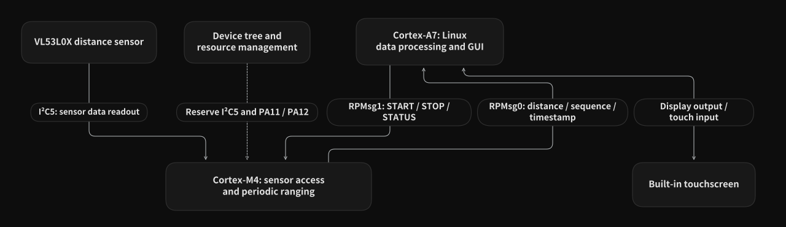

# STM32MP1 Heterogeneous-Core Ranging and Visualization Platform

[繁體中文](README.md) | **English**

This project integrates **Cortex-A7 Linux**, **Cortex-M4**, a **VL53L0X time-of-flight distance sensor**, and the built-in touchscreen on the **STM32MP157F-DK2**.

Cortex-M4 handles sensor access and periodic ranging; Cortex-A7 handles touchscreen controls and graphical display. Both cores communicate bidirectionally through **OpenAMP/RPMsg**.

The main engineering focus is **board support package (BSP) and system integration**: pin/peripheral ownership, device-tree configuration, sensor API porting, remote firmware loading, cross-core messaging, and automatic startup.

## Technical Documentation

- [Peripheral resource configuration](docs/tof.md#資源分配): How the device tree assigns I²C5 and PA11/PA12 to M4.
- [Cross-core communication design](docs/tof.md#通訊分工): How the two RPMsg channels carry measurement data and control commands.
- [Build and deployment workflow](docs/build-and-run.md): Cross-compilation, firmware loading, and automatic startup.

These detailed guides are currently available in Traditional Chinese.

## BSP and Low-Level Integration

| Area | Implemented Work |
| --- | --- |
| Kernel support verification | Verified that STM32 remote-processor and resource-management support is enabled for M4 firmware loading and peripheral management. |
| Device-tree and boot integration | Built the ranging-specific DTB, configured its boot entry, and verified the running device tree and pin ownership. |
| Peripheral ownership | Disabled I²C5 in the Linux device tree and reserved PA11/PA12 through M4 resource nodes. |
| M4 peripheral initialization | Configured I²C5, GPIO alternate functions and clock gating, using a hardware semaphore for GPIO configuration protection. |
| Sensor API porting | Connected the ST VL53L0X API to STM32 HAL, handling address representation, multibyte transfers and errors. |
| Startup debugging | Traced I²C timeouts after software reset; added startup waiting to achieve ranging. |
| Cross-core communication | Used OpenAMP virtual UART channels with newline-delimited commands, sequence numbers and nonblocking transmission. |
| Linux application | Implemented nonblocking reads/writes, split and merged message handling, timeouts and GUI updates. |
| Boot integration | Used systemd to manage M4 and GUI services while waiting for communication and display readiness. |

ST HAL, OpenAMP, RPMsg drivers and the VL53L0X vendor API are pre-existing components. This project implements resource configuration, porting layers, an application protocol, ranging scheduling, GUI software, and service integration.

## Implemented Features

- M4 communicates with VL53L0X over I²C5, including device identification and actual distance measurements.
- The M4 main loop schedules measurements with a **target period of 100 ms**.
- Two RPMsg channels separate measurement data from control commands.
- The A7 GUI shows the measured distance, bar graph, most recent 20 seconds of history, and device status.
- Touchscreen START/STOP controls distance acquisition on M4.
- The UI reports missing sequence numbers, invalid measurements, and M4 transmission drop counts.
- Boot services load M4 firmware automatically, wait for RPMsg and Wayland readiness, and then launch the GUI.
- After the window opens, measurement remains stopped until the user presses START.

## System Architecture

## Validated Environment

| Component | Version or Configuration |
| --- | --- |
| Development board | STM32MP157F-DK2 |
| Linux kernel | 6.6.129 |
| Development ecosystem | STM32MPU Ecosystem v6.2.1 |
| Kernel baseline | OpenSTLinux 6.6 / Scarthgap, mpu-v26.06.10 |
| Official M4 package | STM32CubeMP1 v1.7.0 |
| M4 starting example | STM32MP157C-DK2 / OpenAMP_TTY_echo |
| Sensor API | STSW-IMG005, VL53L0X 1.0.4, revision 4960 |
| A7 GUI library | GTK 3.24.41 |
| Display environment | Weston / Wayland |
| Firmware identifier | TOF_STREAM_V1 |

The physical board is **F-DK2**. The M4 project uses a **C-DK2** official example path previously verified on the F-DK2 board.

## Wiring

Disconnect power before wiring. Verify connector numbers and silkscreen labels on the board.

| VL53L0X Module | STM32MP157F-DK2 |
| --- | --- |
| VIN | CN16 3V3, pin 4 |
| GND | CN16 GND, pin 6 or 7 |
| SCL | CN13 pin 10, D15 / PA11 / I²C5_SCL |
| SDA | CN13 pin 9, D14 / PA12 / I²C5_SDA |

This version uses four wires and does not use a separate XSHUT or interrupt signal.

## Source-Code Entry Points

| Path | Purpose |
| --- | --- |
| `a7-gui/mp1_tof_monitor.c` | Linux GUI and RPMsg device handling |
| `m4-firmware/source/main.c` | M4 initialization, control commands, measurement scheduling and data transmission |
| `m4-firmware/vl53l0x/port/` | VL53L0X-to-STM32-HAL porting layer |
| `m4-firmware/vl53l0x/vendor/` | Vendor-supplied sensor API |
| `m4-firmware/include/` | Used M4 headers and HAL configuration |
| `m4-firmware/cubeide/CM4/` | Used STM32CubeIDE project settings |
| `bsp/device-tree/` | Device tree dedicated to M4 ranging |
| `systemd/` | Firmware and GUI startup configuration |
| `tools/` | Rebuild and M4 project restoration tools |

## Rebuild and Validation

- [Build and deployment guide](docs/build-and-run.md)
- [Communication protocol, feature validation and limitations](docs/tof.md)
- [Ranging platform release provenance](docs/development-origin.txt)
- [Third-party sources and license notice](NOTICE.md)

This repository is a release snapshot extracted from a previously validated development environment. The SDK, complete Linux kernel source tree, and STM32CubeMP1 package must be installed separately.

## Demonstration Video

A video will be added later. On-board manual validation already covered the GUI, distance changes, START/STOP, and automatic startup after reboot.
