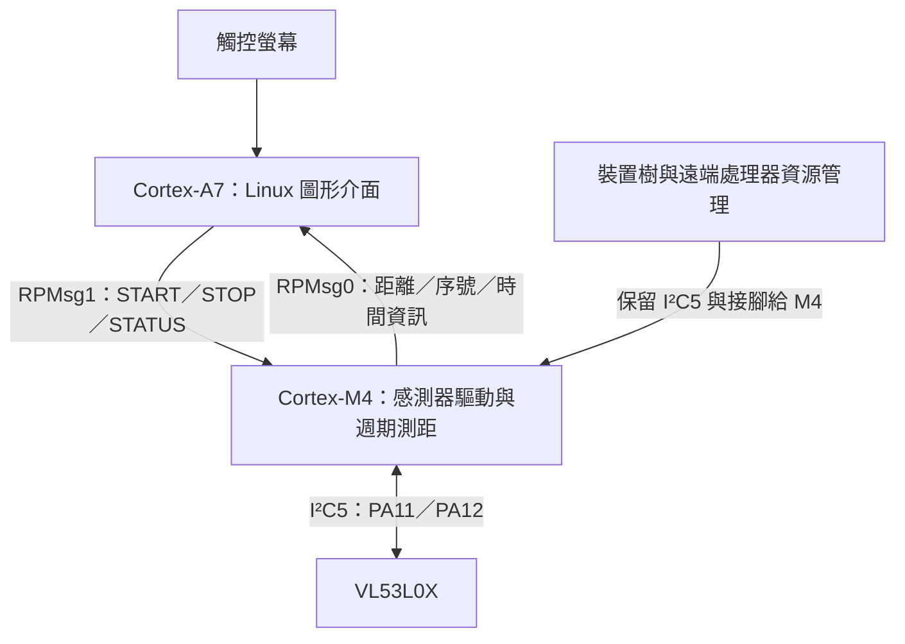

# STM32MP1 異質核心測距與視覺化平台

**繁體中文** | [English](README.en.md)

在 STM32MP157F-DK2 上整合 Cortex-A7 Linux、Cortex-M4、VL53L0X 距離感測器與內建觸控螢幕。

Cortex-M4 負責感測器存取與週期測距，Cortex-A7 負責觸控操作及圖形顯示，兩者透過 OpenAMP／RPMsg 雙向通訊。

專案重點是板級支援套件（BSP）與系統整合：從接腳與周邊資源分配、裝置樹、感測器移植，到韌體載入、核心間通訊及開機自動啟動。

## 技術文件導覽

- [周邊資源配置](docs/tof.md#資源分配)：裝置樹如何將 I²C5 與 PA11／PA12 配置給 M4。
- [跨核心通訊設計](docs/tof.md#通訊分工)：量測資料與控制命令如何透過雙通道 RPMsg 傳遞。
- [建置與部署流程](docs/build-and-run.md)：從交叉編譯、韌體載入到開機自動啟動。

## BSP 與底層整合工作

| 項目 | 本專案完成的工作 |
|---|---|
| 核心支援確認 | 確認 STM32 遠端處理器與資源管理功能已啟用，供 M4 韌體載入與周邊管理使用 |
| 裝置樹與開機整合 | 建置測距專用 DTB，設定開機選項，並核對執行中的裝置樹與接腳使用狀態 |
| 周邊所有權 | 在 Linux 裝置樹停用 I²C5，透過 M4 資源節點保留 PA11、PA12 |
| M4 周邊初始化 | 配置 I²C5、GPIO 複用及時鐘閘控，使用硬體信號量保護 GPIO 配置 |
| 感測器移植 | 將 ST VL53L0X API 接到 STM32 HAL，處理位址格式、多位元組資料與錯誤回報 |
| 啟動問題排查 | 追蹤軟體重置後的 I²C 逾時，加入啟動等待後完成量測 |
| 核心間通訊 | 使用 OpenAMP 虛擬串口，實作換行分隔命令、資料序號與非阻塞傳送 |
| Linux 應用 | 以非阻塞讀寫接收資料，處理訊息拆分、合併、逾時與圖形更新 |
| 開機整合 | 以 systemd 管理 M4 與視窗服務，等待通訊和顯示環境就緒 |

ST HAL、OpenAMP、RPMsg 驅動及 VL53L0X 原廠 API 為既有元件。
本專案的實作範圍是資源配置、移植層、應用協定、量測排程、圖形程式及服務整合。

## 已完成的功能

- M4 透過 I²C5 存取 VL53L0X，完成裝置識別與實際測距。
- 以 100 ms 為目標週期，由 M4 主迴圈安排量測。
- RPMsg 使用兩個通道，分開傳送量測資料與控制命令。
- A7 圖形介面提供距離數字、長條圖、最近 20 秒曲線及狀態資訊。
- 觸控 START／STOP 控制 M4 開始及停止測距。
- 顯示序號缺口、無效量測與 M4 傳送丟棄計數。
- 開機自動載入 M4 韌體，等待 RPMsg 與 Wayland 就緒後開啟視窗。
- 視窗啟動後先保持停止狀態，等待使用者按下 START。

## 系統架構

## 已驗證的環境

| 項目 | 版本或設定 |
|---|---|
| 開發板 | STM32MP157F-DK2 |
| Linux 核心 | 6.6.129 |
| 開發環境 | STM32MPU Ecosystem v6.2.1 |
| 核心來源套件 | OpenSTLinux 6.6／Scarthgap，mpu-v26.06.10 |
| M4 官方套件 | STM32CubeMP1 v1.7.0 |
| M4 起始專案 | STM32MP157C-DK2／OpenAMP_TTY_echo |
| 感測器 API | STSW-IMG005，VL53L0X 1.0.4，修訂版 4960 |
| A7 圖形函式庫 | GTK 3.24.41 |
| 顯示環境 | Weston／Wayland |
| 本專案韌體識別 | TOF_STREAM_V1 |

實體板卡是 F-DK2；M4 工程沿用已在該板驗證的 C-DK2 官方範例路徑。

## 接線

接線前先關閉板子電源，依接頭編號與板上標示確認位置。

| VL53L0X 模組 | STM32MP157F-DK2 |
|---|---|
| VIN | CN16 的 3V3，接頭第 4 腳 |
| GND | CN16 的 GND，第 6 或第 7 腳 |
| SCL | CN13 第 10 腳，D15／PA11／I²C5_SCL |
| SDA | CN13 第 9 腳，D14／PA12／I²C5_SDA |

此版本使用四線連接；未使用額外的 XSHUT 或中斷訊號線。

## 原始碼入口

| 路徑 | 用途 |
|---|---|
| `a7-gui/mp1_tof_monitor.c` | Linux 圖形介面與 RPMsg 串口處理 |
| `m4-firmware/source/main.c` | M4 初始化、控制命令、量測排程與資料傳送 |
| `m4-firmware/vl53l0x/port/` | VL53L0X 與 STM32 HAL 的移植層 |
| `m4-firmware/vl53l0x/vendor/` | 原廠感測器 API |
| `m4-firmware/include/` | 已使用的 M4 標頭與 HAL 配置 |
| `m4-firmware/cubeide/CM4/` | 已使用的 CubeIDE 工程設定 |
| `bsp/device-tree/` | M4 測距專用裝置樹 |
| `systemd/` | 韌體與圖形程式的啟動設定 |
| `tools/` | 重建與 M4 工程還原工具 |

## 重建與驗證

- [重建及部署說明](docs/build-and-run.md)
- [通訊協定、功能驗證與限制](docs/tof.md)
- [測距平台發布來源](docs/development-origin.txt)
- [第三方來源與授權文件](NOTICE.md)

本儲存庫是從已驗證的開發環境整理出的發布快照。
SDK、完整核心原始碼及 STM32CubeMP1 套件需另外安裝。

## 展示影片

影片將於後續補上。目前已完成板端視窗、距離變化、START／STOP 與重新開機後自動啟動的人工驗證。
